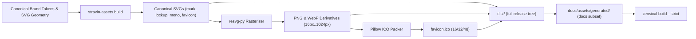

# Asset CLI & Workflow

The `stravin-assets` Python CLI generates every canonical SVG, raster PNG, WebP, and multi-resolution ICO file deterministically from code and syncs the documentation subset into `docs/assets/generated/`.

## Rendering Pipeline



## CLI Reference

Run commands via `uv run stravin-assets` (or `asdf exec make ...`):

### `stravin-assets build`

Generates all canonical SVGs, PNGs, WebP images, and `favicon.ico` into `--out-dir` and copies the documentation preview subset into `--docs-dir`.

```bash
uv run stravin-assets build [--out-dir dist] [--docs-dir docs/assets/generated]
```

| Option | Default | Description |
| :--- | :--- | :--- |
| `--out-dir` | `dist` | Root output directory for the complete generated asset tree |
| `--docs-dir` | `docs/assets/generated` | Target directory synced with the SVG, PNG, and ICO assets referenced by this Zensical site |

### `stravin-assets list`

Prints the full manifest of generated asset targets (relative path, format, dimensions, and variant) without writing files.

```bash
uv run stravin-assets list
```

## Output Tree

```text
dist/
├── svg/
│   ├── stravin-mark-dark.svg
│   ├── stravin-mark-light.svg
│   ├── stravin-mark-mono.svg
│   ├── stravin-mark-mono-1c.svg
│   ├── stravin-lockup-dark.svg
│   ├── stravin-lockup-light.svg
│   ├── stravin-lockup-currentcolor.svg
│   └── favicon.svg
├── png/
│   ├── stravin-mark-dark-{16,32,64,128,256,512,1024}.png
│   ├── stravin-mark-light-{64,128,256,512}.png
│   ├── stravin-lockup-dark-{360,720,1440}.png
│   └── stravin-lockup-light-{360,720,1440}.png
├── webp/
│   ├── stravin-mark-dark-512.webp
│   └── stravin-lockup-dark-720.webp
└── web/
    ├── favicon.ico
    ├── apple-touch-icon.png
    ├── icon-192.png
    └── icon-512.png
```

### Synced Documentation Subset (`docs/assets/generated/`)

The following 12 files are synced into `docs/assets/generated/` (gitignored) before every `zensical build --strict`:

- `stravin-mark-dark.svg`
- `stravin-mark-light.svg`
- `stravin-mark-mono.svg`
- `stravin-mark-mono-1c.svg`
- `stravin-lockup-dark.svg`
- `stravin-lockup-light.svg`
- `stravin-lockup-currentcolor.svg`
- `favicon.svg`
- `favicon.ico`
- `apple-touch-icon.png`
- `stravin-mark-dark-512.png`
- `stravin-lockup-dark-720.png`

## Makefile Targets

All multi-step workflows are orchestrated via `asdf exec make <target>`:

| Target | Command | Description |
| :--- | :--- | :--- |
| `install` | `asdf exec make install` | Sync Python environment and development dependencies with `uv` |
| `assets` | `asdf exec make assets` | Run `stravin-assets build` to populate `dist/` and `docs/assets/generated/` |
| `test` | `asdf exec make test` | Run the `pytest` suite covering SVG geometry, raster output, and CLI behavior |
| `build` | `asdf exec make build` | Generate assets and run `zensical build --strict` into `site/` |
| `serve` | `asdf exec make serve` | Generate assets and launch the local Zensical live-reload server |
| `check` | `asdf exec make check` | Run linting (`ruff`), tests, asset generation, and strict docs verification |
| `clean` | `asdf exec make clean` | Remove generated `dist/`, `docs/assets/generated/`, and `site/` build artifacts |
